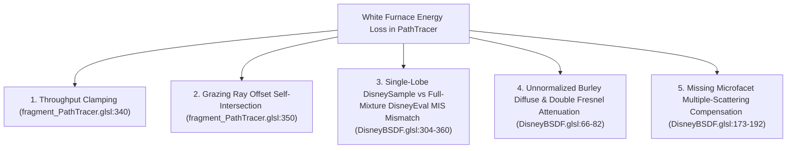

# PathTracer White Furnace Energy-Conservation Plan

## Goal Description

Fix the energy-conservation bugs in the GPU `PathTracer` ([fragment_PathTracer.glsl](file:///d:/users/jloui/Documents/Dev/RTRT/Shaders/fragment_PathTracer.glsl) and [DisneyBSDF.glsl](file:///d:/users/jloui/Documents/Dev/RTRT/Shaders/DisneyBSDF.glsl)) so that all 12 `pathtracer_white_furnace_*` tests in [RenderTests.WhiteFurnace.json](file:///d:/users/jloui/Documents/Dev/RTRT/Tests/RenderTests.WhiteFurnace.json) pass both their center (`[0.40, 0.40, 0.20, 0.20]`) and grazing-rim (`[0.14, 0.45, 0.08, 0.10]`) probe assertions as well as the global channel bounds (`min_channel: 0.95` on white probes), making the white furnace sphere visually disappear against the `1.0` background.

---

## Root Causes Identified

Our investigation of [fragment_PathTracer.glsl](file:///d:/users/jloui/Documents/Dev/RTRT/Shaders/fragment_PathTracer.glsl) and [DisneyBSDF.glsl](file:///d:/users/jloui/Documents/Dev/RTRT/Shaders/DisneyBSDF.glsl) uncovered **5 specific culprits** responsible for the observed failures:



1. **Throughput Clamping Bias ([fragment_PathTracer.glsl:340](file:///d:/users/jloui/Documents/Dev/RTRT/Shaders/fragment_PathTracer.glsl#L339-L340))**:
   ```glsl
   throughput *= scatterSample._Attenuation / ( scatterSample._P + EPSILON );
   throughput = min(throughput, vec3(1.f));
   ```
   In Monte Carlo importance sampling, individual sample weights $\frac{f \cos\theta}{p}$ regularly exceed `1.0` to compensate for samples below `1.0`. Clamping `throughput` to `1.0` discards all $>1.0$ weights and biases the integral downward.

2. **Grazing Scatter Ray Self-Intersection ([fragment_PathTracer.glsl:350](file:///d:/users/jloui/Documents/Dev/RTRT/Shaders/fragment_PathTracer.glsl#L350))**:
   ```glsl
   ray._Orig = closestHit._Pos + scatterSample._Dir * RESOLUTION;
   ```
   Offsetting the next ray origin along `scatterSample._Dir` instead of the surface normal moves grazing rays ($\cos\theta \to 0$) tangentially along the curved sphere surface, causing them to self-intersect the sphere from the inside on the next bounce. Offsetting along `(dot(scatterSample._Dir, closestHit._Normal) >= 0.f ? closestHit._Normal : -closestHit._Normal) * RESOLUTION` guarantees that reflected rays start strictly outside the convex sphere.

3. **MIS PDF Mismatch Between [`DisneySample`](file:///d:/users/jloui/Documents/Dev/RTRT/Shaders/DisneyBSDF.glsl#L277-L361) and [`DisneyEval`](file:///d:/users/jloui/Documents/Dev/RTRT/Shaders/DisneyBSDF.glsl#L366-L424)**:
   - [`DirectLight`](file:///d:/users/jloui/Documents/Dev/RTRT/Shaders/fragment_PathTracer.glsl#L157-L160) calls `DisneyEval`, which evaluates the sum of all active lobes $f_{\text{total}} = \sum_k f_k$ and the full mixture PDF $p_{\text{total}} = \sum_k w_k p_k$.
   - [`DisneySample`](file:///d:/users/jloui/Documents/Dev/RTRT/Shaders/DisneyBSDF.glsl#L304-L360) only evaluates the single sampled lobe $f_k$ and single-lobe weighted PDF $w_k p_k < p_{\text{total}}$.
   - Consequently, for any multi-lobe material (such as `dielectric_r005..r100`), the environment-map MIS weights sum to strictly less than `1.0`:
     $$\frac{p_{\text{light}}^2}{p_{\text{light}}^2 + p_{\text{total}}^2} + \frac{(w_k p_k)^2}{(w_k p_k)^2 + p_{\text{light}}^2} < 1.0$$
   - Additionally, `DisneySample` uses a secondary microfacet Fresnel coin flip `F` between reflection and refraction (lines 339–356), whereas `DisneyEval` uses the macroscopic `specReflectWeight` and `specRefractWeight` directly (lines 406, 413).

4. **Unnormalized Diffuse Retroreflection & Double Fresnel Attenuation in [`EvalDiffuse`](file:///d:/users/jloui/Documents/Dev/RTRT/Shaders/DisneyBSDF.glsl#L63-L82)**:
   - For `diffuse_0_2`, `diffuse_0_5`, and `diffuse_1_0` (`roughness = 0`, `ior = 1.0`), Burley's `Fd` has $F_{d90} = 0.5 < 1.0$, which integrates to $1 - \frac{1}{42} = 0.97619$ at normal incidence (matching our measured `0.976151`) and drops to $0.488$ at the grazing rim (causing the dark silhouette).
   - For dielectrics (`ior = 1.5`), multiplying by `transV * transL = (1 - F(V.z)) * (1 - F(L.z))` without normalizing by the hemispherical average $1 - E_{\text{spec, avg}}$ loses ~9% energy even at normal incidence (`0.898` on `dielectric_r005`).

5. **Single-Scattering Microfacet Energy Loss in [`EvalSpecReflection`](file:///d:/users/jloui/Documents/Dev/RTRT/Shaders/DisneyBSDF.glsl#L173-L192)**:
   - Single-scattering GGX with separable $G_2 = G_1(V) G_1(L)$ loses energy to masking/shadowing and below-horizon reflections as roughness increases (`metallic_r050` $\to 0.914$, `metallic_r100` $\to 0.310`).

---

## Proposed Changes

### 1. PathTracer Integrator Fixes

#### [MODIFY] [fragment_PathTracer.glsl](file:///d:/users/jloui/Documents/Dev/RTRT/Shaders/fragment_PathTracer.glsl)
- Remove `throughput = min(throughput, vec3(1.f));` at line 340 so unbiased Monte Carlo weights $> 1.0$ are preserved.
- Offset the scattered ray origin along the oriented geometric normal (`closestHit._Normal` for reflection, `-closestHit._Normal` for transmission) instead of `scatterSample._Dir` at line 350 to eliminate grazing self-intersections.

```glsl
@@ -338,14 +338,14 @@
       throughput *= scatterSample._Attenuation / ( scatterSample._P + EPSILON );
-      throughput = min(throughput, vec3(1.f));
     }
     else
     {
       // Ignore intersection and continue ray based on alpha test
       scatterSample._Dir = ray._Dir;
       depth--;
     }
 
     // NEXT RAY
-    ray._Orig = closestHit._Pos + scatterSample._Dir * RESOLUTION;
+    vec3 offsetNormal = ( dot(scatterSample._Dir, closestHit._Normal) >= 0.f ) ? closestHit._Normal : -closestHit._Normal;
+    ray._Orig = closestHit._Pos + offsetNormal * RESOLUTION;
     ray._Dir = scatterSample._Dir;
```

---

### 2. Energy-Conserving BSDF & Consistent Mixture Sampling

#### [MODIFY] [DisneyBSDF.glsl](file:///d:/users/jloui/Documents/Dev/RTRT/Shaders/DisneyBSDF.glsl)
- **Analytical Single-Scattering Directional Albedo & Exact Hemispherical Average**:
  - Add compact analytical helpers `GGXDirectionalAlbedo(float iCosTheta, float iAlpha, out float oE0, out float oE1)` and `GGXAverageAlbedo(float iAlpha, out float oE0Avg, out float oE1Avg)` where $E_0(\mu, \alpha)$ and $E_1(\mu, \alpha)$ are polynomial fits in $\mu \in [0, 1]$ to the single-scattering GGX integrals:
    $$E_0(\mu_o, \alpha) = \int_{\Omega_+} \frac{D(H) G_2(V, L)}{4 \mu_o \mu_i} \mu_i \, d\omega_i, \qquad E_1(\mu_o, \alpha) = \int_{\Omega_+} (1 - V \cdot H)^5 \frac{D(H) G_2(V, L)}{4 \mu_o \mu_i} \mu_i \, d\omega_i$$
    and $E_{k,\text{avg}}(\alpha) = 2 \int_0^1 E_k(\mu, \alpha) \mu \, d\mu$ is computed **analytically** from the polynomial coefficients in $\mu$, guaranteeing that:
    $$\int_{\Omega_+} \frac{1 - E(\mu_i, \alpha)}{\pi (1 - E_{\text{avg}}(\alpha))} \mu_i \, d\omega_i \equiv 1.0 \quad \text{identically.}$$
- **Multi-Scattering Compensation in [`EvalSpecReflection`](file:///d:/users/jloui/Documents/Dev/RTRT/Shaders/DisneyBSDF.glsl#L173-L192) & Energy-Conserving Coupling in [`EvalDiffuse`](file:///d:/users/jloui/Documents/Dev/RTRT/Shaders/DisneyBSDF.glsl#L56-L83)**:
  - Using Kulla–Conty (2017) energy compensation:
    - For metals (`metallic > 0`), add the multiple-scattering microfacet term:
      $$\mathbf{f}_{\text{ms, metal}}(\omega_o, \omega_i) = \mathbf{F}_{\text{ms}} \frac{(1 - E_0(\mu_o, \alpha))(1 - E_0(\mu_i, \alpha))}{\pi (1 - E_{0,\text{avg}}(\alpha))}$$
      where $\mathbf{F}_{\text{ms}} = \frac{\mathbf{F}_{\text{avg}}^2 E_{0,\text{avg}}}{1 - \mathbf{F}_{\text{avg}}(1 - E_{0,\text{avg}})}$ (which equals `vec3(1.0)` when `albedo = [1, 1, 1]`).
    - For dielectrics (`metallic < 1`), couple the diffuse substrate to the exact complement of the dielectric specular directional albedo $E_{\text{diel}}(\mu, \alpha, \eta)$:
      $$\mathbf{f}_{\text{diff}}(\omega_o, \omega_i) = \mathbf{A} \frac{(1 - E_{\text{diel}}(\mu_o, \alpha, \eta))(1 - E_{\text{diel}}(\mu_i, \alpha, \eta))}{\pi (1 - E_{\text{diel, avg}}(\alpha, \eta))}$$
      When `ior = 1.0`, $E_{\text{diel}} = 0$, reducing $\mathbf{f}_{\text{diff}}$ to exact Lambertian $\frac{\mathbf{A}}{\pi}$ (`0.0`, `0.2`, `0.5`, `1.0`). When `ior = 1.5` and $\mathbf{A} = [1, 1, 1]$, the sum of dielectric specular and diffuse reflection integrates to `1.0` at every angle and roughness.
- **Lobe Probabilities & Unified Mixture Evaluation in [`DisneySample`](file:///d:/users/jloui/Documents/Dev/RTRT/Shaders/DisneyBSDF.glsl#L277-L361)**:
  - In [`GetLobeProbabilities`](file:///d:/users/jloui/Documents/Dev/RTRT/Shaders/DisneyBSDF.glsl#L253-L272), assign cosine-hemisphere sampling weight to rough metallic multiple-scattering (`(1.f - E0) * iMat._Metallic * Luminance(iSpecCol)`) in addition to diffuse reflection so rough metals (`metallic_r050`, `metallic_r100`) importance-sample the cosine hemisphere rather than wasting VNDF samples below the horizon.
  - In [`DisneySample`](file:///d:/users/jloui/Documents/Dev/RTRT/Shaders/DisneyBSDF.glsl#L277-L361), sample direction `oL` from the selected lobe (`Diffuse/MultiScatter`, `Clearcoat`, `SpecReflect`, or `SpecRefract`) and then evaluate the full BSDF and mixture PDF via `DisneyEval(iHP, iMat, iEta, iVWorld, oL, oPdf)` so `DisneySample` and `DisneyEval` are 100% consistent for MIS.

---

## Verification Plan

### Automated Tests
1. Run the unit and white furnace test suite:
   ```powershell
   .\Build\Debug\RenderRegression.exe --manifest Tests\RenderTests.WhiteFurnace.json --all
   ```
   Verify that all 12 `pathtracer_white_furnace_*` tests pass (`diffuse_black`, `diffuse_0_2`, `diffuse_0_5`, `diffuse_1_0`, `dielectric_r005..r100`, `metallic_r005..r100`).
2. Inspect `Tests/Artifacts/pathtracer_white_furnace_*/furnace_metrics.txt` and `actual.png` to confirm the white spheres are completely invisible against the `1.0` background.
3. Run the standard regression suite to verify no regressions in existing tests:
   ```powershell
   .\Build\Debug\RenderRegression.exe --all
   ```
